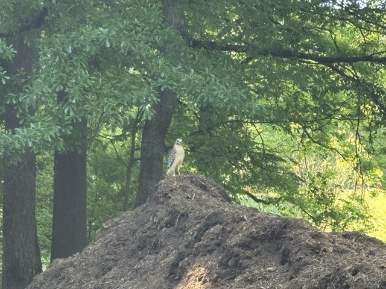
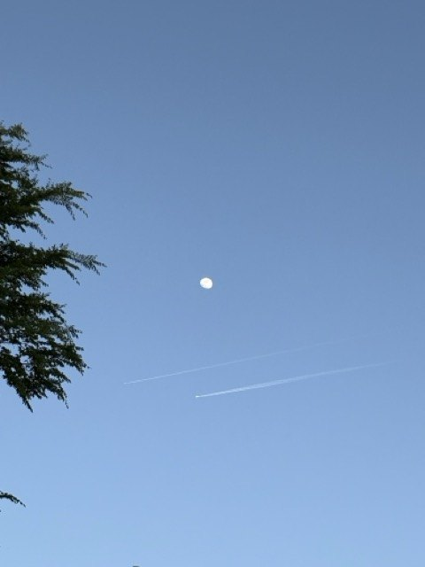
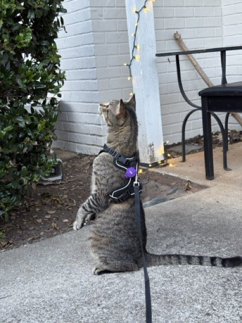
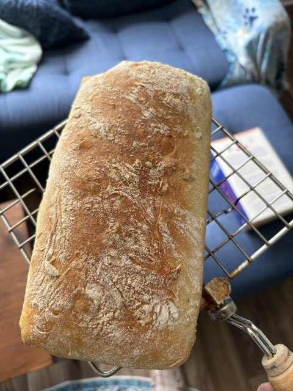
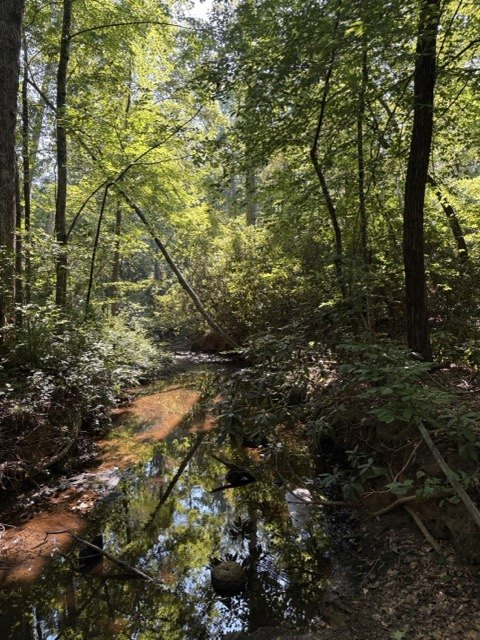
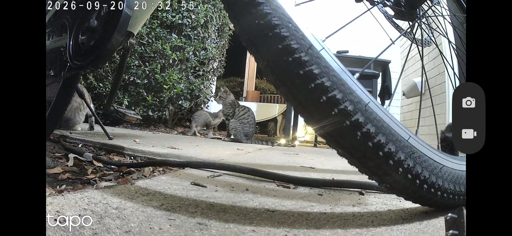
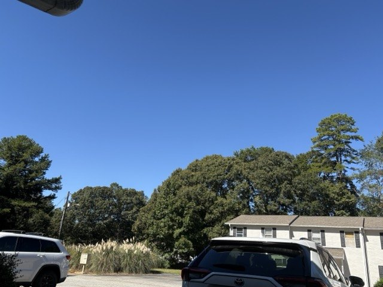
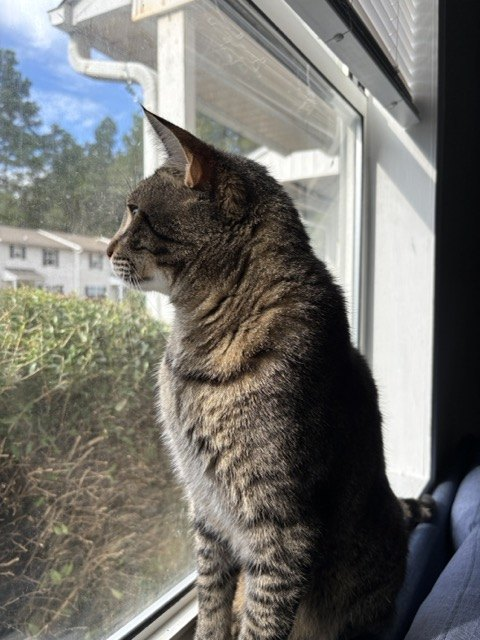

# Image examples

OpenDecision uses SigLIP2 to match images against candidate captions. The examples below show the supplied captions, returned answers, and composed actions.

These 11 photos were tested with the image API. Each table shows the statement or question and the returned answer.

[Image API and setup](image-decisions.md) · [Run the image demo](https://github.com/deepanwadhwa/OpenDecision/tree/main/demos/images)

Times are medians of five local HTTP calls on an Apple M3 with the model loaded. Each time includes all questions listed for that photo. [Measurement details](image-decisions.md#api-call-times).

## Results

### Wildlife alert

**API call: 316 ms** for 2 questions.

{ .od-gallery-image loading=lazy }

| Statement or question | Returned answer |
| --- | --- |
| An animal is visible in the image. | Yes |
| What kind of animal is visible? | `bear` |

Rule: `animal_present` is true and `animal_type` equals `bear`.

Returned action: **`sound_alarm`**. The action is simulated.

??? info "Captions and returned scores"

    **`animal_present`** (noul)

    - `true`: An animal is visible in the image.
    - `false`: A scene without any animals.

    ```json
    {
      "type": "noul",
      "noul": 0.9854469299316406
    }
    ```

    **`animal_type`** (choice)

    - `cat`: A photo of a cat.
    - `dog`: A photo of a dog.
    - `coyote`: A photo of a coyote.
    - `bear`: A photo of a bear.
    - `other_animal`: A photo of another kind of animal.
    - `no_animal`: A landscape without any animals.

    ```json
    {
      "type": "choice",
      "choice": "bear",
      "probabilities": {
        "cat": 4.2180534364888445e-05,
        "dog": 0.00014694735000375658,
        "coyote": 0.000802758033387363,
        "bear": 0.9885395169258118,
        "other_animal": 0.010174029506742954,
        "no_animal": 0.00029455311596393585
      },
      "confidence": 0.9620985402679022
    }
    ```


### Bin collection

**API call: 240 ms** for 3 questions.

{ .od-gallery-image loading=lazy }

| Statement or question | Returned answer |
| --- | --- |
| A photo of a trash bin. | Yes |
| What condition is the bin in? | `overflowing` |
| Rubbish scattered across the floor around a bin. | Yes |

Rule: `bin_present` is true and `bin_condition` equals `overflowing`.

Returned action: **`request_collection`**. The action is simulated.

??? info "Captions and returned scores"

    **`bin_present`** (noul)

    - `true`: A photo of a trash bin.
    - `false`: A photo of an empty room.

    ```json
    {
      "type": "noul",
      "noul": 0.9997207522392273
    }
    ```

    **`bin_condition`** (choice)

    - `empty`: An empty trash bin.
    - `contained`: A trash bin holding rubbish neatly inside.
    - `overflowing`: A trash bin overflowing with rubbish piled on top and spilling onto the floor.

    ```json
    {
      "type": "choice",
      "choice": "overflowing",
      "probabilities": {
        "empty": 0.02629130892455578,
        "contained": 0.27365437150001526,
        "overflowing": 0.7000542879104614
      },
      "confidence": 0.3629010822262866
    }
    ```

    **`ground_litter`** (noul)

    - `true`: Rubbish scattered across the floor around a bin.
    - `false`: A clean and tidy floor around a bin.

    ```json
    {
      "type": "noul",
      "noul": 0.9977849721908569
    }
    ```


### Fence repair

**API call: 266 ms** for 3 questions.

{ .od-gallery-image loading=lazy }

| Statement or question | Returned answer |
| --- | --- |
| A photo of a metal fence. | Yes |
| What condition is the fence in? | `damaged` |
| What material is the fence made of? | `other` |

Rule: `fence_present` is true and `fence_condition` equals `damaged`.

Returned action: **`create_repair_task`**. The action is simulated.

??? info "Captions and returned scores"

    **`fence_present`** (noul)

    - `true`: A photo of a metal fence.
    - `false`: A photo of plants in a forest.

    ```json
    {
      "type": "noul",
      "noul": 0.9967530369758606
    }
    ```

    **`fence_condition`** (choice)

    - `intact`: A straight upright metal fence in good condition.
    - `damaged`: A bent and collapsed metal fence leaning over in vegetation.
    - `unclear`: A fence mostly hidden behind plants, with its condition unclear.

    ```json
    {
      "type": "choice",
      "choice": "damaged",
      "probabilities": {
        "intact": 6.503957411041483e-05,
        "damaged": 0.9995725750923157,
        "unclear": 0.00036233218270353973
      },
      "confidence": 0.9964272309629573
    }
    ```

    **`fence_material`** (choice)

    - `metal`: A metal fence made of iron bars.
    - `wood`: A wooden fence made of boards.
    - `wire_mesh`: A fence made of flexible wire mesh.
    - `other`: A fence made of another material.

    ```json
    {
      "type": "choice",
      "choice": "other",
      "probabilities": {
        "metal": 0.1567850559949875,
        "wood": 0.08964116871356964,
        "wire_mesh": 0.03200826793909073,
        "other": 0.7215655446052551
      },
      "confidence": 0.3851610518055971
    }
    ```


### Bird in the woods

**API call: 317 ms** for 4 questions.

{ .od-gallery-image loading=lazy }

| Statement or question | Returned answer |
| --- | --- |
| A bird is visible in the image. | Yes |
| An eagle is visible in the image. | Yes |
| A person is visible in the image. | No |
| What kind of bird is visible? | `other_bird` |

??? info "Captions and returned scores"

    **`bird_present`** (noul)

    - `true`: A bird is visible in the image.
    - `false`: A scene without any birds.

    ```json
    {
      "type": "noul",
      "noul": 0.9660131335258484
    }
    ```

    **`eagle_present`** (noul)

    - `true`: An eagle is visible in the image.
    - `false`: A scene without an eagle.

    ```json
    {
      "type": "noul",
      "noul": 0.8165377378463745
    }
    ```

    **`human_present`** (noul)

    - `true`: A person is visible in the image.
    - `false`: A wild bird among trees in a forest.

    ```json
    {
      "type": "noul",
      "noul": 0.0017106442246586084
    }
    ```

    **`bird_kind`** (choice)

    - `eagle`: A photo of an eagle.
    - `hawk`: A photo of a hawk.
    - `owl`: A photo of an owl.
    - `other_bird`: A photo of another bird.
    - `no_bird`: A scene without birds.

    ```json
    {
      "type": "choice",
      "choice": "other_bird",
      "probabilities": {
        "eagle": 0.051251474767923355,
        "hawk": 0.16163183748722076,
        "owl": 0.08185870200395584,
        "other_bird": 0.6947102546691895,
        "no_bird": 0.010547762736678123
      },
      "confidence": 0.4080094712923271
    }
    ```


### Moon in the sky

**API call: 233 ms** for 3 questions.

{ .od-gallery-image loading=lazy }

| Statement or question | Returned answer |
| --- | --- |
| Which celestial object is visible? | `moon` |
| An airplane is visible in the sky. | Yes |
| A tree is visible in the image. | Yes |

??? info "Captions and returned scores"

    **`sky_object`** (choice)

    - `moon`: The moon visible in a blue sky.
    - `sun`: The sun visible in a blue sky.
    - `neither`: A blue sky without the moon or sun visible.

    ```json
    {
      "type": "choice",
      "choice": "moon",
      "probabilities": {
        "moon": 0.7818400859832764,
        "sun": 0.17475949227809906,
        "neither": 0.04340038076043129
      },
      "confidence": 0.4234408001266272
    }
    ```

    **`plane_present`** (noul)

    - `true`: An airplane is visible in the sky.
    - `false`: Sky with no airplane visible.

    ```json
    {
      "type": "noul",
      "noul": 0.7038407921791077
    }
    ```

    **`tree_present`** (noul)

    - `true`: A tree is visible in the image.
    - `false`: A scene without any trees.

    ```json
    {
      "type": "noul",
      "noul": 0.8658673763275146
    }
    ```


### Cat on a patio

**API call: 234 ms** for 3 questions.

{ .od-gallery-image loading=lazy }

| Statement or question | Returned answer |
| --- | --- |
| A cat is visible in the image. | Yes |
| How many cats are visible? | `one` |
| A cat is sleeping or napping. | No |

??? info "Captions and returned scores"

    **`cat_present`** (noul)

    - `true`: A cat is visible in the image.
    - `false`: A scene without any cats.

    ```json
    {
      "type": "noul",
      "noul": 0.9102864265441895
    }
    ```

    **`cat_count`** (choice)

    - `zero`: A scene with no cats.
    - `one`: A photo of one cat.
    - `multiple`: A photo of two or more cats.

    ```json
    {
      "type": "choice",
      "choice": "one",
      "probabilities": {
        "zero": 0.055449433624744415,
        "one": 0.7995275855064392,
        "multiple": 0.14502301812171936
      },
      "confidence": 0.4363100113079119
    }
    ```

    **`cat_napping`** (noul)

    - `true`: A cat is sleeping or napping.
    - `false`: A cat is awake, sitting upright and looking around.

    ```json
    {
      "type": "noul",
      "noul": 0.0040166135877370834
    }
    ```


### Bread on a cooling rack

**API call: 85 ms** for 1 question.

{ .od-gallery-image loading=lazy }

| Statement or question | Returned answer |
| --- | --- |
| How many loaves of bread are visible? | `one` |

??? info "Captions and returned scores"

    **`bread_count`** (choice)

    - `zero`: A scene without bread.
    - `one`: One loaf of bread on a cooling rack.
    - `multiple`: Two or more loaves of bread on a cooling rack.

    ```json
    {
      "type": "choice",
      "choice": "one",
      "probabilities": {
        "zero": 0.0010277321562170982,
        "one": 0.8948542475700378,
        "multiple": 0.10411805659532547
      },
      "confidence": 0.6886767894020007
    }
    ```


### Water in the woods

**API call: 233 ms** for 3 questions.

{ .od-gallery-image loading=lazy }

| Statement or question | Returned answer |
| --- | --- |
| A backyard is flooded with standing water. | Yes |
| A shallow stream of water running through a wooded area. | Yes |
| What best describes the water scene? | `wooded_creek` |

??? info "Captions and returned scores"

    **`backyard_flooded`** (noul)

    - `true`: A backyard is flooded with standing water.
    - `false`: A backyard is dry and free of standing water.

    ```json
    {
      "type": "noul",
      "noul": 0.8128588795661926
    }
    ```

    **`water_present`** (noul)

    - `true`: A shallow stream of water running through a wooded area.
    - `false`: A dry forest floor covered in plants and fallen branches.

    ```json
    {
      "type": "noul",
      "noul": 0.9993311166763306
    }
    ```

    **`water_scene`** (choice)

    - `flooded_yard`: A backyard flooded with water covering the lawn.
    - `wooded_creek`: A creek or stream running through a wooded area.
    - `dry_yard`: A dry backyard without water on the ground.

    ```json
    {
      "type": "choice",
      "choice": "wooded_creek",
      "probabilities": {
        "flooded_yard": 7.847583765396848e-05,
        "wooded_creek": 0.9998863935470581,
        "dry_yard": 3.519013989716768e-05
      },
      "confidence": 0.9988928978738509
    }
    ```


### Animals on a patio

**API call: 514 ms** for 5 questions.

{ .od-gallery-image loading=lazy }

| Statement or question | Returned answer |
| --- | --- |
| How many animals are visible? | `one` |
| A photo of a bear. | No |
| A photo of a coyote. | No |
| An animal is visible in the image. | Yes |
| What kind of animal is visible? | `cat` |

Rule: `animal_present` is true and `animal_type` equals `bear`.

Returned action: **`no_alarm`**. The action is simulated.

??? info "Captions and returned scores"

    **`animal_count`** (choice)

    - `zero`: An outdoor scene without animals.
    - `one`: One animal on a patio.
    - `multiple`: Several animals together on a patio.

    ```json
    {
      "type": "choice",
      "choice": "one",
      "probabilities": {
        "zero": 0.04124877601861954,
        "one": 0.7521222233772278,
        "multiple": 0.2066289633512497
      },
      "confidence": 0.3887085165327596
    }
    ```

    **`bear_present`** (noul)

    - `true`: A photo of a bear.
    - `false`: A photo of a cat.

    ```json
    {
      "type": "noul",
      "noul": 0.03849371522665024
    }
    ```

    **`coyote_present`** (noul)

    - `true`: A photo of a coyote.
    - `false`: A photo of a cat.

    ```json
    {
      "type": "noul",
      "noul": 0.052384644746780396
    }
    ```

    **`animal_present`** (noul)

    - `true`: An animal is visible in the image.
    - `false`: A scene without any animals.

    ```json
    {
      "type": "noul",
      "noul": 0.9874376654624939
    }
    ```

    **`animal_type`** (choice)

    - `cat`: A photo of a cat.
    - `dog`: A photo of a dog.
    - `coyote`: A photo of a coyote.
    - `bear`: A photo of a bear.
    - `other_animal`: A photo of another kind of animal.
    - `no_animal`: A landscape without any animals.

    ```json
    {
      "type": "choice",
      "choice": "cat",
      "probabilities": {
        "cat": 0.8867677450180054,
        "dog": 0.01656363531947136,
        "coyote": 0.049020957201719284,
        "bear": 0.035501569509506226,
        "other_animal": 0.012059740722179413,
        "no_animal": 8.643681212561205e-05
      },
      "confidence": 0.7237879201664215
    }
    ```


### Weather and parked cars

**API call: 191 ms** for 2 questions.

{ .od-gallery-image loading=lazy }

| Statement or question | Returned answer |
| --- | --- |
| What weather is visible? | `sunny` |
| How many parked cars are visible? | `two` |

??? info "Captions and returned scores"

    **`weather`** (choice)

    - `sunny`: A sunny day with a clear blue sky.
    - `rainy`: A rainy day with rain falling.
    - `cloudy`: An overcast day with gray clouds.
    - `night`: A dark nighttime scene.

    ```json
    {
      "type": "choice",
      "choice": "sunny",
      "probabilities": {
        "sunny": 0.9859010577201843,
        "rainy": 0.002233620034530759,
        "cloudy": 0.009337893687188625,
        "night": 0.0025274145882576704
      },
      "confidence": 0.9376820523920272
    }
    ```

    **`parked_car_count`** (choice)

    - `zero`: A driveway with no parked cars.
    - `one`: A driveway with one parked car.
    - `two`: A driveway with two parked cars.
    - `three_or_more`: A driveway with three or more parked cars.

    ```json
    {
      "type": "choice",
      "choice": "two",
      "probabilities": {
        "zero": 0.20297342538833618,
        "one": 0.25532975792884827,
        "two": 0.3041783571243286,
        "three_or_more": 0.23751848936080933
      },
      "confidence": 0.0076392976526203915
    }
    ```


### Cat at a window

**API call: 180 ms** for 2 questions.

{ .od-gallery-image loading=lazy }

| Statement or question | Returned answer |
| --- | --- |
| A cat is visible in the image. | Yes |
| Where is the cat looking? | `window` |

??? info "Captions and returned scores"

    **`cat_present`** (noul)

    - `true`: A cat is visible in the image.
    - `false`: A scene without any cats.

    ```json
    {
      "type": "noul",
      "noul": 0.8177101612091064
    }
    ```

    **`cat_gaze`** (choice)

    - `camera`: A cat facing and looking directly at the camera.
    - `window`: A cat looking out of a window, shown in profile.
    - `elsewhere`: A cat looking elsewhere inside the room.

    ```json
    {
      "type": "choice",
      "choice": "window",
      "probabilities": {
        "camera": 0.00216315477155149,
        "window": 0.9727381467819214,
        "elsewhere": 0.02509867027401924
      },
      "confidence": 0.8792590849353216
    }
    ```


## Notes from these examples

- The surveillance photo contains multiple animals. The model returned `one`.
- The damaged fence is metal. The material question returned `other`.
- The car-count question returned `two` with a winning probability of 0.304.
- The bird species has not been verified. Contrails are visible in the sky photo. The usual water level in the wooded channel is unknown.
- Negated captions produced false positives during testing. Concrete alternatives improved several results.

The rules use a Noul threshold of 0.5 and require a winning Choice probability of at least 0.6. Missing or weak answers produce an unknown rule status. Scores are uncalibrated.
