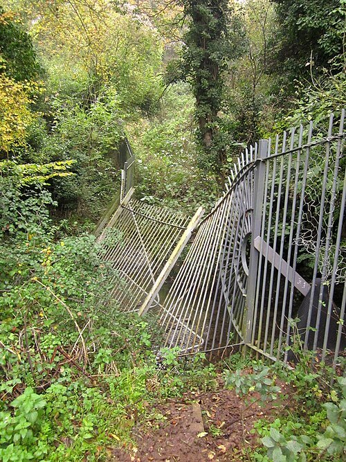

# OpenDecision

OpenDecision answers typed questions about text, JSON, documents, and images. It runs locally and returns structured values.

[](quickstart.md#memory)
[](quickstart.md#memory)
[](quickstart.md#input-limits)
[](quickstart.md#input-limits)

Measured on CPU with short inputs and the default models. Longer inputs and simultaneous requests can use more memory. [Memory details](quickstart.md#memory).

Text context is **512 tokens for Choice, Score, and Relation**, or **8,192 tokens for yes/no (`Noul`)**, including the question text sent to the model. Tokens are pieces of words. Images are resized to **224 × 224 pixels**, with **64 tokens per caption**. The document API splits longer documents into passages. [Input limits](quickstart.md#input-limits).

## Text decisions

### Route a customer request

> I was charged twice and I need this fixed before my meeting this afternoon.

| Question | Answer |
| --- | --- |
| Which department should handle this? | `billing` |
| Is this request urgent? | Yes |

```python
if department == "billing" and urgent:
    action = "prioritize_billing_request"
```

**API call: 231 ms** for both questions.

### Read an insurance claim

The sample claim includes policy facts, medical records, bills, and employer records.

| Question | Answer |
| --- | --- |
| Are the medical expenses documented? | `established` |
| Is a serious injury documented? | `refuted` |
| Are documents still outstanding? | `established` |

These insurance answers come from the saved claim benchmark.

[More text and document examples](examples.md) · [Document API](document-decisions.md)

## Image decisions

Ask questions about a photo and combine the answers into an action.

<div class="od-image-example" markdown="1">
<div class="od-image-photo" markdown="1">

{ loading=lazy }

</div>
<div class="od-image-results" markdown="1">

### Wildlife alert

| Question | Answer |
| --- | --- |
| Is an animal visible? | Yes |
| What kind of animal is visible? | `bear` |

```python
if animal_present and animal_type == "bear":
    action = "sound_alarm"
```

Returned action: **`sound_alarm`**.

**API call: 318 ms** for 2 questions.

</div>
</div>

<div class="od-image-example" markdown="1">
<div class="od-image-photo" markdown="1">

{ loading=lazy }

</div>
<div class="od-image-results" markdown="1">

### Bin collection

| Question | Answer |
| --- | --- |
| Is a bin visible? | Yes |
| What condition is the bin in? | `overflowing` |
| Is litter scattered on the floor? | Yes |

```python
if bin_present and bin_condition == "overflowing":
    action = "request_collection"
```

Returned action: **`request_collection`**.

**API call: 234 ms** for 3 questions.

</div>
</div>

<div class="od-image-example" markdown="1">
<div class="od-image-photo" markdown="1">

{ loading=lazy }

</div>
<div class="od-image-results" markdown="1">

### Fence repair

| Question | Answer |
| --- | --- |
| Is a fence visible? | Yes |
| What condition is the fence in? | `damaged` |

```python
if fence_present and fence_condition == "damaged":
    action = "create_repair_task"
```

Returned action: **`create_repair_task`**.

**API call: 155 ms** for 2 questions.

</div>
</div>

Times are medians of five local HTTP calls on an Apple M3 with the models loaded. Each payload received one warmup call. The timer includes sending the request and reading the response. [Measurement details](image-decisions.md#api-call-times).

These are recorded results from SigLIP2. The actions are simulated. The rules use a yes/no threshold of 0.5 and require a winning Choice probability of at least 0.6.

[See more images, questions, and answers](image-examples.md) · [Image API and setup](image-decisions.md)

## Install

With `pip`:

```bash
pip install OpenDecision
```

With `uv`:

```bash
uv add OpenDecision
```

[Continue to the get started guide](quickstart.md)

## What it provides

| Type | Use | Result |
| --- | --- | --- |
| `Choice` | Select one option. | Option name and probabilities |
| `Noul` | Test one statement. | A score from 0 to 1 |
| `Score` | Use an ordered scale. | Weighted score and probabilities |
| `Relation` | Compare evidence with a statement and its opposite. | `supports`, `contradicts`, `unknown`, or `conflicted` |
| Document decisions | Ask questions about text or JSON. | Answers and source passages |
| Image decisions | Ask questions about a photo. | Answers and rule decisions |

[See code examples for each primitive](primitives.md)

## Start here

- [Get started](quickstart.md): install the package, run a Python example, and start the API.
- [Primitives](primitives.md): use `Choice`, `Noul`, `Score`, and `Relation`.
- [Image examples](image-examples.md): photos, questions, returned answers, and combined rules.
- [Image decisions](image-decisions.md): install image support and send API requests.
- [Document decisions](document-decisions.md): ask questions about long text or JSON and select a yes/no mode.
- [Evidence and rules](evidence-and-rules.md): rank evidence and combine facts with rules.
- [Examples](examples.md): run the Doom demo and review the insurance and GDPR examples.

## Interfaces

| Interface | Use |
| --- | --- |
| Python | Call OpenDecision in the same process as the application. |
| `POST /v1/systemone` | Send state and typed questions to the API. |
| `POST /v1/documents/decide` | Send a document and typed questions to the API. |
| TypeSafe-compatible endpoint | Use a compatible TypeSafe SDK client with a local server. |

## Basic example

```python
from opendecision import OpenDecisionEngine

engine = OpenDecisionEngine()

result = engine.choice(
    state="The customer was charged twice.",
    instructions="Which team should handle this request?",
    criteria={
        "billing": "Payments, invoices, refunds, and duplicate charges",
        "technical": "Software bugs",
        "sales": "Pricing and purchases",
    },
)

print(result["choice"])
# billing
```

## Doom demo

OpenDecision chooses actions for a bot in ViZDoom's Deadly Corridor. This is the Skill 5 recording.

<video class="od-video" controls autoplay muted loop playsinline preload="metadata">
  <source src="https://cdn.jsdelivr.net/gh/deepanwadhwa/OpenDecision@main/demos/doom/opendecision-doom-skill5.mp4" type="video/mp4">
  Your browser does not support embedded video. <a href="https://github.com/deepanwadhwa/OpenDecision/blob/main/demos/doom/opendecision-doom-skill5.mp4">Open the recording</a>.
</video>

[Watch Skill 1](https://github.com/deepanwadhwa/OpenDecision/blob/main/demos/doom/opendecision-doom-skill1.mp4) | [Watch Skill 3](https://github.com/deepanwadhwa/OpenDecision/blob/main/demos/doom/opendecision-doom-skill3.mp4) | [Run the demo](https://github.com/deepanwadhwa/OpenDecision/blob/main/demos/doom/README.md)
